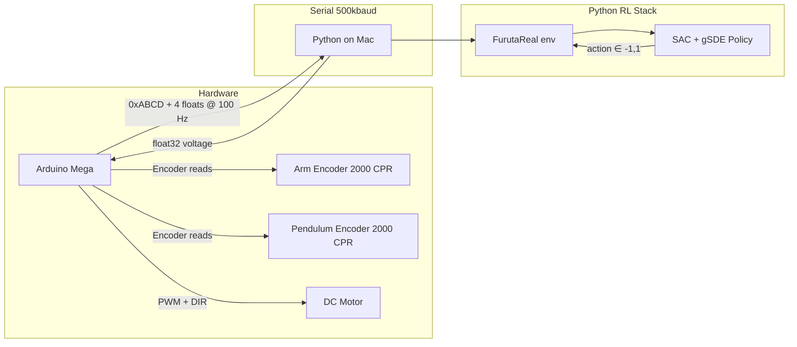

# Furuta Pendulum Swing-Up — Project Walkthrough

## What Is This?

This is a **sim-to-real reinforcement learning project** for a [Furuta (rotary inverted) pendulum](https://en.wikipedia.org/wiki/Furuta_pendulum). The goal: train an RL agent (SAC + gSDE) to **swing the pendulum from hanging → upright** and balance it there, first in simulation, then fine-tune on real hardware.

> [!IMPORTANT]
> This is a 6th semester EDL (Electronics Design Lab) college project — real physical hardware controlled by a neural network in real-time.

---

## System Architecture



---

## File Map

| File | Purpose |
|------|---------|
| [config.py](config.py) | Physical constants (masses, lengths, inertias, motor params) and constraints (12V, dt=0.01s, 2500 max steps) |
| [furuta_utils.py](furuta_utils.py) | State index labels (`ALPHA`=arm, `THETA`=pendulum), velocity filter, timing |
| [qube_dynamics.py](qube_dynamics.py) | Equations of motion (Euler-Lagrange) with domain randomization support |
| [furuta_env.py](furuta_env.py) | Gymnasium env for **simulation** (`FurutaSim`) — physics stepping, reward, obs |
| [furuta_real.py](furuta_real.py) | Gymnasium env for **real hardware** (`FurutaReal`) — serial comms with Arduino |
| [train.py](train.py) | SAC+gSDE training in **simulation** |
| [train_real.py](train_real.py) | SAC fine-tuning on **real hardware** with auto-resume from checkpoints |
| [bootstrap_from_csv.py](bootstrap_from_csv.py) | Pre-fill replay buffer from classical controller CSV data |
| [eval.py](eval.py) | Evaluate trained policy in simulation |
| [rl_inference.py](rl_inference.py) | **Final deployment** — runs the SAC policy on hardware; pairs with `prop_on_ard.ino` (LQR runs on the Arduino) |
| [deploy_real.py](deploy_real.py) | Older deployment — SAC swing-up + LQR in Python; pairs with `arduino_firmware.ino` |
| [simulate.py](simulate.py) | 2D live animation (arm top-down + pendulum side view) |
| [visualize.py](visualize.py) | 3D live visualization with live plots (angle, voltage history) |
| [probe_hardware.py](probe_hardware.py) | Debug tool — passive 0V read from Arduino to verify encoder conventions |
| [arduino_firmware.ino](arduino_firmware/arduino_firmware.ino) | Arduino Mega firmware used for training — encoder reading, velocity filtering, motor PWM, serial protocol |
| [prop_on_ard.ino](prop_on_ard/prop_on_ard.ino) | **Final firmware** — same protocol, plus on-board LQR and the RL/LQR blending logic |

---

## Conventions

| Symbol | Meaning | Zero position |
|--------|---------|---------------|
| **θ** (THETA) | Pendulum angle | **0 = UPRIGHT** (unstable equilibrium) |
| **α** (ALPHA) | Arm angle | 0 = boot position |
| State vector | `[α, θ, α̇, θ̇]` | — |
| Observation (6D) | `[cos α, sin α, cos θ, sin θ, α̇, θ̇]` | Trig encoding avoids discontinuities |
| Action | Scalar in `[-1, 1]` | Scaled to `±max_voltage` (12V) |


---

## Physics / Dynamics

The equations of motion in [qube_dynamics.py](qube_dynamics.py) implement the **Euler-Lagrange formulation** for a rotary inverted pendulum:

- **Motor model**: `τ = kt(V - km·α̇) / Rm` with stall torque clamping
- **Mass matrix** `M`, **Coriolis** `C`, **gravity** `G` → solve `M·q̈ = τ - C - G - D·q̇`
- **Domain randomization**: every episode reset calls `dyn.randomize()` which perturbs all physical parameters by their `_std` (currently all 0, but ready to use)
- Integration: Euler method at 500 Hz substeps within each 100 Hz control step

---

## Reward Function

The primary reward used is **`exp_alpha_2`**:

```
r = exp_pendulum_reward(state, exp=2) × arm_reward(state)
```

- **`exp_pendulum_reward`**: Exponentially shaped — peaks at θ=0 (upright), zero at θ=±π (hanging). The `exp` parameter controls sharpness.
- **`arm_reward`**: Soft penalty for large arm angles — discourages spinning the arm wildly.
- Combined: reward is maximum **only** when pendulum is upright AND arm is near center.

---

## Training Pipeline

### Phase 1: Simulation Training ([train.py](train.py))

```
python bootstrap_from_csv.py --csv classical_data_real.csv --out buffer.pkl
python train.py --total_timesteps 300000 --replay_buffer buffer.pkl
```

- **Algorithm**: SAC (Soft Actor-Critic) with **gSDE** (generalized State-Dependent Exploration) — better than Gaussian noise for continuous control
- **Key hyperparams**: lr=3e-4, buffer=1M, batch=256, γ=0.99, τ=0.005, sde_sample_freq=64
- **Wide initial state**: pendulum starts at random angle ∈ [-π, π] so agent sees all configurations
- **Termination**: speed limits (60 rad/s arm, 400 rad/s pendulum), arm angle limit (±90°), or full pendulum revolution (wire safety)
- **Bootstrap**: Optional pre-fill of replay buffer from classical controller data (CSV from prior experiments)
- **Eval**: Every 10k steps, 5 deterministic rollouts; best model saved

### Phase 2: Hardware Fine-Tuning ([train_real.py](train_real.py))

```
python train_real.py --port /dev/cu.usbmodem1401 \
    --model runs/sac_gsde/best/best_model.zip \
    --replay_buffer runs/sac_gsde/buffer.pkl \
    --ent_coef 0.05
```

- Loads sim-trained policy as starting point
- **Auto-resume**: finds latest `sac_real_*_steps.zip` checkpoint on restart
- **Checkpoints** every 2000 steps (model + replay buffer)
- **Action smoothing**: EMA with α=0.3 to prevent voltage spikes on real motor
- **Arm recentering at reset**: gently pushes arm back toward 0° before waiting for pendulum to settle hanging
- **Gradient steps = 1** (conservative for hardware safety)
- **Fixed entropy** (`ent_coef=0.05`) — auto-tuning disabled because checkpoint compatibility issues
- Runs indefinitely until Ctrl+C

---

## Arduino Firmware

The [firmware](arduino_firmware/arduino_firmware.ino) runs on an **Arduino Mega** at **100 Hz**:

- **Encoders**: 2000 CPR quadrature encoders on arm and pendulum, read via hardware interrupts
- **Velocity**: finite difference + 0.25/0.75 exponential smoothing filter
- **TX** (to Python): `0xABCD` sync word + 16 bytes `{θ_pend, θ_arm, ω_pend, ω_arm}` as float32s
- **RX** (from Python): 4-byte float32 voltage command
- **Safety**: motor cuts off if no command received for 100ms (watchdog)
- **Deadzone compensation**: voltages below 0.5V are zeroed (motor friction threshold)
- **No safety cutoff on pendulum angle** — full swing-through allowed for swing-up training

---

## Final Deployment (Hybrid RL + LQR)

The final demo runs the RL policy for swing-up and an LQR controller for balancing. The LQR runs **on the Arduino**, so the balancing loop has no serial latency.

[prop_on_ard.ino](prop_on_ard/prop_on_ard.ino) picks the motor voltage from the pendulum's distance from upright:

| Distance from upright | Controller |
|---|---|
| > 20° | RL voltage received from Python |
| 10°–20° | Fixed blend: 0.4 × RL + 0.6 × LQR |
| < 10° | LQR only (`k1..k4` gains in the sketch) |

### Hardware setup

**Components**
- Arduino Mega 2560 (the four encoder lines need its external-interrupt pins 18–21)
- Two 2000 CPR quadrature encoders: one on the arm (motor shaft), one on the pendulum pivot
- DC motor driving the arm, through a PWM + DIR motor driver
- 12 V supply for the motor driver (the firmware assumes `SUPPLY_VOLTAGE = 12.0`)
- USB cable from the Arduino to the laptop

**Wiring** (set at the top of `prop_on_ard.ino`)

| Signal | Arduino Mega pin |
|---|---|
| Arm encoder A / B | 20 / 21 |
| Pendulum encoder A / B | 19 / 18 |
| Motor driver PWM | 5 |
| Motor driver DIR | 4 |
| Encoder and driver GND | GND (shared with the 12 V supply ground) |

The encoder inputs use the Arduino's internal pull-ups (`INPUT_PULLUP`). Power the encoders from the Arduino's 5 V pin, after checking their rated voltage.

**Software**
- Arduino IDE, with the board set to *Arduino Mega or Mega 2560*
- Python 3 and the dependencies: `pip install -r requirements.txt`

**Before powering the motor**
- Check that the arm can swing about ±90° freely, without hitting anything or pulling on cables.
- If the arm moves the wrong way, or the pendulum angle has the wrong sign, change `MOTOR_SIGN`, `ARM_SIGN` or `PEND_SIGN` in the sketch. Don't rewire.
- Use `probe_hardware.py` to check the encoder readings with the motor off.

### How to run

1. Flash `prop_on_ard/prop_on_ard.ino` to the Arduino Mega, then **close the Serial Monitor**.
2. Let the pendulum **hang still** and centre the arm. The encoders zero when the board boots, and opening the port from Python resets the board.
3. Find the port: `ls /dev/cu.usbmodem*`
4. Run:
   ```
   python3 rl_inference.py --port /dev/cu.usbmodem1401 \
       --model runs/sac_real/ckpts/sac_real_407500_steps.zip
   ```
5. Press Ctrl+C to stop. This sends 0 V and closes the port.

The script recentres the arm, waits for the pendulum to settle, and starts the swing-up. Keep `--action_smoothing` (0.3) and `--max_voltage` (12) at their training values. If the angles look wrong, run `python3 probe_hardware.py --port ...` (motor off) and check the angle conventions by hand.

### Saved models

| Path | Description |
|---|---|
| `runs/sac_real/ckpts/sac_real_407500_steps.zip` | Final hardware fine-tuned policy (used in the demo) |
| `runs/sac_real/ckpts/sac_real_replay_buffer_407500_steps.pkl` | Matching replay buffer (for resuming `train_real.py`) |
| `runs/sac_real/model.zip` | Last saved model of the `sac_real` run |
| `runs/sac_real/ckpts/sac_real_12027_steps.zip` | Early hardware checkpoint |
